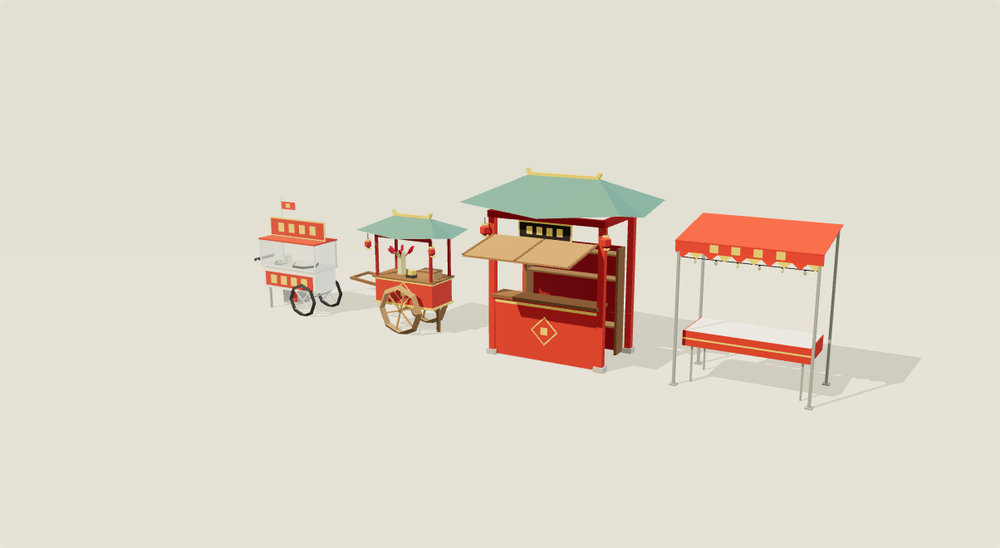

# Китайский рынок: тележки и прилавки · GLB

Четыре оригинальные процедурные low-poly модели для «Шэньчжэньского экспресса»:
две тележки уличной еды на колёсах и два пустых прилавка, которые клиент заполняет едой.
Геометрия, плоские нормали, цвета вершин и анимации встроены в GLB.
Внешних текстур, сжатия и обязательных glTF-расширений нет.



| Файл | Треугольники | Draw calls | Слоты | Размер | Габариты X × Y × Z |
|---|---:|---:|---:|---:|---|
| [cart_jianbing.glb](cart_jianbing.glb) | 712 | 7 | — | 90 228 байт | 1,56 × 2,01 × 0,80 м |
| [cart_tanghulu.glb](cart_tanghulu.glb) | 830 | 8 | — | 105 792 байт | 1,97 × 2,09 × 1,00 м |
| [stall_pavilion.glb](stall_pavilion.glb) | 566 | 5 | 10 | 71 344 байт | 2,64 × 2,91 × 2,67 м, с поднятой ставней |
| [stall_awning.glb](stall_awning.glb) | 514 | 4 | 6 | 63 736 байт | 2,00 × 2,33 × 1,20 м |

**Тележка цзяньбин** (`cart_jianbing`) — современная городская тележка с блинами 煎饼:
белый эмалированный корпус с красной панелью и четырьмя «иероглифами», круглая плита
с тестом под стеклом, ведро с тестом, яйца и зелень, красная вывеска, флажок,
газовый баллон под днищем, два колеса, опоры и ручка.

**Тележка танхулу** (`cart_tanghulu`) — традиционная тележка из красного лака:
деревянные колёса со спицами и длинные оглобли, золотые пояса, ромб «福»,
мини-крыша пагоды с загнутыми углами на красных столбиках, два красных фонарика,
соломенный сноп с шпажками засахаренного боярышника 糖葫芦, котелок с сиропом и короб для сладостей.

**Прилавок-павильон** (`stall_pavilion`) — деревянный павильон на четырёх красных колоннах
на каменных базах под черепичной вальмовой крышей с загнутыми углами и золотым коньком,
чёрная табличка-вывеска 牌匾, лакированный прилавок с ромбом «福», стеллаж с тремя полками,
два фонарика. Деревянная ставня поднята навесом над прилавком и опускается клипом Close.

**Прилавок под тентом** (`stall_awning`) — складная палатка ночного рынка: каркас из труб,
красный тент с фестонами-флажками и вывеской, гирлянда лампочек, стол с красной скатертью.

Прилавки пустые: на столешницах и полках расставлены точки-якоря для еды (см. «Слоты»).

## Оптимизация

- лимиты генератора: не больше 1 000 треугольников и 16 draw calls на модель;
- примитивы с 5–8 гранями, перекладины — прямоугольные бруски;
- цвет хранится в вершинах (`COLOR_0`), материалов всего три: `paint`, `glass` (прозрачный),
  `cloth` (двусторонний: черепица, тент, флажки);
- неподвижные детали запечены в один меш на материал; отдельные меши только у подвижных узлов.

## Координаты

- Единица — метр; +Y вверх; сторона покупателя смотрит по +Z.
- Корневой узел — центр модели на уровне земли (Y=0).
- Тележки катятся вдоль X: ручка со стороны −X, при толкании едут к +X.
- Иерархия жёстких частей с анимацией узлов, без скелета и skinning.

## Слоты для еды

Пустые узлы `Slot_<группа>_<n>` — дочерние узлы корня. Позиция слота — точка на поверхности,
куда ставится **нижний центр** предмета; поворот слота нулевой (предмет смотрит на покупателя, +Z).

| Модель | Группы слотов |
|---|---|
| `stall_pavilion` | `Counter` — 4 на прилавке (Y = 0,99); `Shelf` — 6 на двух верхних полках (Y = 1,215 и 1,615). Нижняя полка — склад за прилавком, без слотов |
| `stall_awning` | `Table` — 6 на столе, два ряда по три (Y = 0,78) |

```js
const slots = [];
stall.traverse(o => { if (o.name.startsWith('Slot_')) slots.push(o); });
for (const slot of slots) slot.add(foodModel.clone());   // предмет наследует позицию слота
```

Слоты не попадают в число draw calls и треугольников. В просмотрщике кнопка «Слоты» показывает их зелёными точками.

## Анимации

| Клип | Длительность | Модели | Что двигается |
|---|---|---|---|
| Idle | 4 с, цикл | все | цзяньбин: флажок; танхулу и павильон: фонарики; тент: фестоны и гирлянда |
| Roll | 2 с, цикл | тележки | колёса делают один оборот, флажок/фонарики отклоняются назад и качаются |
| Open | 1,5 с, однократно | тележки | цзяньбин: стеклянное окно для покупателя откидывается вверх; танхулу: крышка короба со сладостями открывается |
| Close | 1,5 с, однократно | павильон | ставня-навес опускается и закрывает проём над прилавком |

Open/Close проигрываются один раз и удерживают конечную позу; обратное действие — тот же клип
с `timeScale = -1`. Скорость Roll ≈ 1 м/с у цзяньбина и ≈ 1,25 м/с у танхулу; для другой скорости
меняйте `timeScale` пропорционально. Idle и Open/Close двигают разные узлы и могут играть одновременно;
на время Roll остановите Idle.

Анимируемые узлы: `L_Wheel`, `R_Wheel`, `Flag`, `FrontWindow`, `L_Lantern`, `R_Lantern`,
`CandyLid`, `Shutter`, `Valance`, `Lights`.

## Просмотр

Из этой директории:

```bash
npm ci
npm run serve
```

Открыть http://127.0.0.1:8766: выбор модели или группы (тележки / прилавки), ракурса,
клипа (Ожидание / Едет / Открыть / Закрыть) и показ слотов.
HTML нельзя открывать через file://: GLTFLoader загружает файлы по HTTP.
Все JS-зависимости локальные после `npm ci`; CDN и интернет при просмотре не нужны.

## Использование в Three.js

Копии GLB лежат в `client/public/models/market/` и доступны клиенту по пути `/models/market/…`.
Создавайте отдельный AnimationMixer для каждого экземпляра.

```js
import * as THREE from 'three';
import { GLTFLoader } from 'three/addons/loaders/GLTFLoader.js';

const gltf = await new GLTFLoader().loadAsync('/models/market/cart_tanghulu.glb');
const cart = gltf.scene;
cart.position.set(104, 0, 118);
scene.add(cart);

const mixer = new THREE.AnimationMixer(cart);
const clip = name => mixer.clipAction(THREE.AnimationClip.findByName(gltf.animations, name));
const idle = clip('Idle'), roll = clip('Roll'), open = clip('Open');
idle.play();

open.setLoop(THREE.LoopOnce, 1);
open.clampWhenFinished = true;
function setOpen(isOpen) {
  open.paused = false;
  open.timeScale = isOpen ? 1 : -1;
  if (!open.isRunning()) open.reset().play();
  if (!isOpen) open.time = open.getClip().duration;
}
// Во время перемещения тележки: idle.stop(); roll.play(); в render-loop: mixer.update(deltaSeconds).
```

## Перегенерация и проверки

Генератор требует только Python 3, не использует Blender, сеть или случайные числа.
Повторный запуск создаёт идентичные байты GLB, обновляет `manifest.json`
и копирует GLB в `client/public/models/market/`.

```bash
python3 generate.py
npm run validate
npm run previews
```

`npm run validate` проверяет все файлы Khronos glTF Validator и дополнительные условия:
GLB 2.0, внутренние ресурсы, нормали, лимиты треугольников и draw calls, имена и длительность клипов,
отсутствие двух каналов на один узел, число и пустоту слотов.

`npm run previews` поднимает временный HTTP-сервер на 127.0.0.1:8767, открывает установленный
Google Chrome через Playwright, проверяет загрузку, клипы и слоты, поворот колёс в Roll,
движение частей в Open и Close, отсутствие ошибок консоли и неудачных запросов, затем сохраняет
изображения в `previews/`. Другой Chromium: `PLAYWRIGHT_CHROMIUM_EXECUTABLE=<путь>`.

Проверено: Chrome на macOS, 1280 × 1000. Все GLB: 0 ошибок, 0 предупреждений валидатора.
Интеграция в игровой клиент и серверные изменения не выполнялись.
